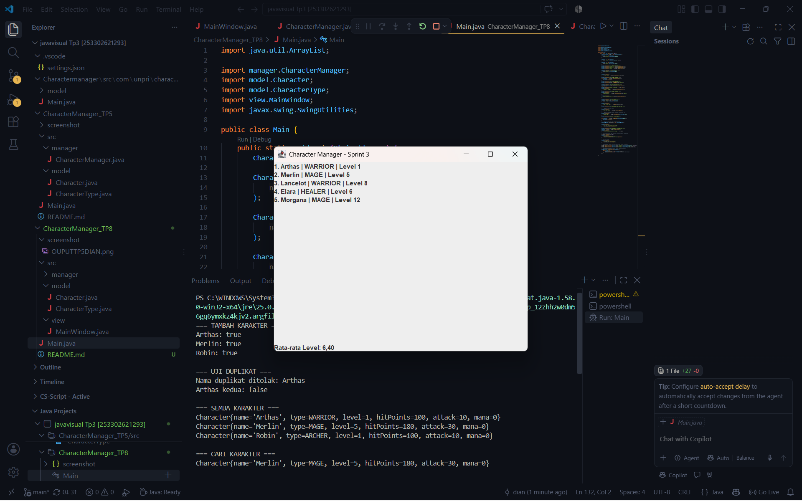
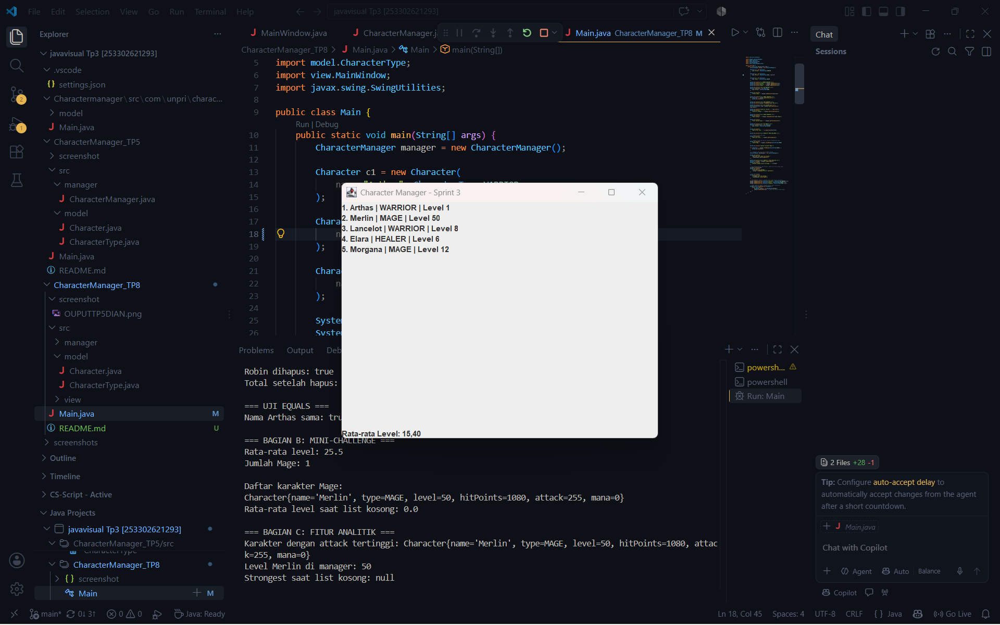

Character Manager — TP3 (Java Visual SIH-6406)

Deskripsi
Character Manager merupakan program sederhana berbasis Java untuk mengelola karakter game. Program ini menggunakan konsep OOP seperti class, constructor, enum, encapsulation, getter, dan setter. Fitur tambahannya adalah atribut mana dengan validasi nilai negatif serta method `isAlive()` untuk memeriksa apakah karakter masih hidup.

Screenshot Output Terminal

[Screenshot Output Terminal](screenshots/DIANOUTPUTTP3.png)

Struktur Folder Project
JAVAVISUAL TP3 [253302621293]/
├── .vscode/
│   └── settings.json
├── Charactermanager/
│   └── src/
│       └── com/
│           └── unpri/
│               └── charactermanager/
│                   ├── Main.java
│                   └── model/
│                       ├── .java5
│                       └── CharacterType.java
├── screenshots/
│   └── DIANOUTPUTTP3.png
└── README.md

Identitas Mahasiswa

Nama Lengkap:Dian Enda Hapsari
NIM:253302621293
Google Docs Bagian D: [Klik di sini](https://docs.google.com/document/d/1EnGNuJ_O0jHTm5pgvTzrEUnLDiQgN19IORD_BQLvz6A/edit?tab=t.0)

 TP 8 (MainWindow, Data Dinamis & Analisis MVC)

-Screenshot MainWindow
MainWindow TP8 

-Screenshot setelah data diubah (level Merlin dari 5 menjadi 50, rata-rata level ikut berubah dari 6,40 menjadi 15,40): 
-Aliran Data: Main, CharacterManager, MainWindow dikaitkan dengan MVC
Main membuat objek CharacterManager lalu mengisinya dengan karakter lewat method addCharacter(). Setelah data siap, Main membuat MainWindow di dalam SwingUtilities.invokeLater() dan mengirim objek CharacterManager ke konstruktornya. MainWindow kemudian mengambil daftar karakter lewat getAllCharacters() dan rata-rata level lewat getAverageLevel(), lalu menampilkannya ke JLabel menggunakan perulangan. Dalam konsep MVC, CharacterManager dan Character adalah Model yang menyimpan data, MainWindow adalah View yang menampilkan data, sedangkan Controller belum ada karena belum ada input dari pengguna yang perlu diproses.

-Karakter Baru
    Nama    :lancelot
    tipe    :warrior
    level   :8
    alasan  :menambahkan karakter bertipe warrior dengan level menengah sebagai pembanding  arthas yang masih level 1.
    
    Nama    :elara
    tipe    :healer
    level   :6
    alasan  :menambahkan tipe healer yang sebelumnya belum pernah ada du daftar, sehingga semua tipe karakter terwakili. 

    Nama    :morgana
    tipe    :mage
    level   :12
    alasan  :dibuat dengan level tertinggi agar selisih level antar karakter besar dan rata rata level terlihat jelas saat data diubah. 

-Analisis GUI dan MVC
Link Google Docs (Bagian D): https://docs.google.com/document/d/10FKY3LqzMJsd6WPgZMXqHFIh4QsDaMAtAMfWeSDFqm4/edit?usp=sharing
